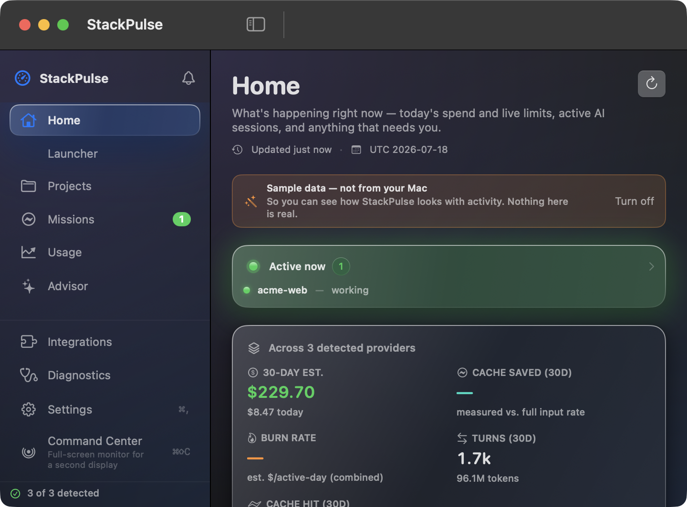

<h1 align="center">StackPulse</h1>

<p align="center">
  <strong>A local-first command center for AI-assisted development on macOS.</strong>
</p>

<p align="center">
  Reads the logs your AI coding tools already write to disk — and tells you where
  your tokens went, how close you are to your limits, and what needs your attention.
  <br>No account. No API key. Nothing leaves your Mac.
</p>

<p align="center">
  <a href="https://github.com/saasmaster/stackpulse-mac/actions/workflows/ci.yml"></a>
  
  
  
  
</p>

<p align="center">
  <a href="#build">Build</a> ·
  <a href="docs/USAGE.md">Usage guide</a> ·
  <a href="#read-this-before-you-trust-a-number">Why you can trust the numbers</a> ·
  <a href="CHANGELOG.md">Changelog</a>
</p>

<p align="center">
  
</p>

---

## What it shows you

- **Live limits, before you're blocked.** Your Claude 5-hour and weekly limits,
  with a forecast — *"at this pace, ~5 hr to the limit"* — and a heads-up while
  there's still room to react, not at 95%.
- **Where the money went.** Per-model, per-window token and cost breakdowns for
  Claude Code and Codex, read from local logs. Every figure is a labeled estimate,
  never presented as your bill.
- **What your agents are doing.** Live Claude / Codex / Antigravity sessions
  observed on this Mac — what each is working on, right now.
- **Your projects.** Launch a dev server in one tap, run remembered commands, see
  which projects your spend went to, and whether each stack is current and secure.
- **Is it working?** A Diagnostics screen that answers "is StackPulse healthy, and
  if not, exactly what to fix" — plus a redacted, secret-free support bundle.

It lives in your menu bar. Everything is read locally; the Rust core makes no
network calls at all, and the app is offline by default with three named,
opt-in exceptions.

> **Its defining constraint is honest reporting:** it labels every number with
> where it came from, it refuses to guess a price it does not know, and it
> documents its gaps instead of hiding them. The rest of this README is mostly
> about *when not to trust a number* — which is exactly the point.

<p align="center">
  
</p>

---

## Status

Working and used daily against real Claude Code and Codex CLI logs. Built from
source; there is no signed release.

Four independent version lines ([ADR-0006](docs/decisions/0006-independent-version-lines.md)):
protocol **1.20.0**, core **0.1.0**, the app (see [`CHANGELOG.md`](CHANGELOG.md)),
and a compatibility manifest that does not exist yet. `stackpulse ping` is
authoritative for the first two.

## Read this before you trust a number

Three things, stated plainly.

### 1. Costs are local list-price estimates. They are not your bill.

Every dollar figure is computed on your machine by multiplying local token counts
against an **embedded table of approximate public list prices**
(`crates/stackpulse-core/src/pricing.rs`, as of `2026-07-17`). Costs are always
tagged `LocalEstimate`.

StackPulse cannot see your invoice, plan, discounts, or credits. On a
subscription, the figure is an *equivalent metered list-price* estimate — what
that volume would cost at pay-as-you-go rates, which is usually far more than you
paid. Useful. Not a bill.

### 2. An unpriced model has its tokens counted and its cost silently omitted.

If `rates_for()` does not recognize a model — an unknown family, **or an
unrecognized version of a known family** — it returns `None`. The core
**deliberately refuses to guess**. The tokens still count; the cost is dropped
from every total.

That silence is the failure mode, so protocol 1.18.0 added **schema canaries**
(`UsageSnapshot.canaries`) to name it. Every snapshot now carries a per-provider
canary (`ok` / `drifted` / `no_data`) listing any unpriced model with its record
and token counts, so the app can say *"I might be under-reporting"* instead of
showing a confidently wrong total. Canaries cover **Claude and Codex** — the only
two providers with local token accounting to verify.

Strictness is only safe *because* the canary surfaces the gap. The two are a pair,
and they exist because of a real incident: tolerant substring matching once priced
**Opus 4.8 at Opus 4.1's rates — 3× the real price**, silently, overstating a
month's spend by 2.7× on a real machine. A wrong rate looks exactly like a right
one. `rates_for()` now parses the version instead.

### The price table's known inaccuracies

Stated in `pricing.rs`, not hidden. Both are live today:

1. **A GPT/Codex model we have not verified is left *unpriced*, not guessed.**
   The Claude cards and the GPT-5 / Codex models actually seen in local logs
   (`gpt-5.5`, `gpt-5.6-sol`, `gpt-5.3-codex`, …) were read off each vendor's
   published list. Any GPT/Codex id we do **not** recognize — a later generation,
   or the internal `codex-*` tooling ids — returns `None`, so its tokens count but
   its cost is dropped and the **canary reports the gap** rather than borrowing a
   sibling's rate.
2. **Data-residency and fast-mode multipliers are not modelled.** A `us`
   data-residency turn bills 1.1×, and fast mode has its own card; nothing local
   says which a turn used, so applying either would be a guess.

Rates are hand-maintained (`PRICING_AS_OF = "2026-07-17"`) and pinned in tests.
Announced future changes with an effective date (e.g. Sonnet 5's introductory
price through 2026-08-31) are **date-aware** — `rates_for()` prices each record by
*its own* date, so the table doesn't silently go wrong on the switch-over day.
There is no remote price feed.

### 3. Eleven providers are registered. Two have a full usage scan.

| Providers | What they do |
| --- | --- |
| **Claude, Codex** | Full local cost scan — per-model, cache metrics, real numbers. Codex also reports 5-hour / weekly limit windows from local logs, **zero network**. |
| **Antigravity** | **Activity only** — conversations, recency, model, step counts. Its tokens/cost live server-side at Google and **are not available locally, so they are not shown**. |
| **Copilot, Cursor, Devin, Gemini, Grok, OpenCode, OpenRouter, Z.ai** | **Detection-only** — installed / authenticated, presence-only. No usage, no cost, no limits. |

Full matrix: [`docs/CAPABILITIES.md`](docs/CAPABILITIES.md).

## Offline by default, with three named exceptions

**The Rust core never makes a network call** — it has no HTTP client
([ADR-0005](docs/decisions/0005-portable-core-boundary.md)). `GetStackHealth`
accepts a `check_updates` flag and ignores it.

Every request that **leaves your machine** is in the Swift layer. This is the
complete list:

| Feature | Endpoint | Sends | Default |
| --- | --- | --- | --- |
| Claude live limits | `api.anthropic.com/api/oauth/usage` | Your Claude Code OAuth token (Bearer) | **ON** |
| BYOK balances | OpenRouter `/credits`, your LiteLLM `/key/info`, DeepSeek `/user/balance` | The key you saved | OFF — no key, no contact |
| Stack Health enrichment | `registry.npmjs.org`, `crates.io`, `api.osv.dev` | Package names + versions | Off unless you ask |

**Claude live limits is on by default and reads a real secret** — your OAuth
token, from `~/.claude/.credentials.json` or the Keychain via `/usr/bin/security`
(which triggers the macOS allow-access prompt). It goes to that one endpoint and
nowhere else; it is never logged or persisted. Turn it off in Settings for a
fully offline app. Details: [`docs/USAGE.md`](docs/USAGE.md#what-touches-the-network).

Two local-only connections are not in that table because nothing leaves the
machine: Project web preview probes `127.0.0.1:<port>` and renders your own dev
server. StackPulse itself **opens no listening socket** — the core is linked
in-process, so there is no port to reach it on.

Everything else is read-only local scanning. Credential *detection* is
presence-only — the file or Keychain item exists; it is never opened.

## Not built

Named so nobody assumes otherwise:

- **Chrome native-messaging host** — no extension exists.
- **Signed / notarized release, DMG, Sparkle auto-update** — needs an Apple
  Developer certificate. `make package` builds an ad-hoc bundle for local use only.
- **Windows client** — the core is portable and CI cross-compiles it, but no
  Windows UI exists.
- **Remote pricing feed**, **signed compatibility manifest** — designed, not built.

## Architecture

A **portable Rust core** does all platform-neutral work — detection, log
scanning, normalization, pricing, aggregation — and speaks a small versioned JSON
protocol. The **macOS app** is a Swift package that links the core as a static
library **in-process** (no subprocess, no IPC, no localhost port) and decodes the
same JSON the CLI prints.

```
              ┌──────────────────────────────────────────────┐
              │  stackpulse-protocol   (versioned contracts) │
              └──────────────────────────────────────────────┘
                         ▲                        ▲
                         │ types                  │ types
              ┌──────────┴──────────┐   ┌─────────┴────────────┐
              │   stackpulse-core   │   │    Swift decoders    │
              │  (portable engine)  │   │  (apps/StackPulseMac)│
              └──────────┬──────────┘   └─────────▲────────────┘
                         │                        │
         ┌───────────────┼─────────────┐          │ JSON in / JSON out
         │               │             │          │
   stackpulse-cli   stackpulse-ffi ────┘  (C ABI: sp_core_handle_request)
   (stackpulse bin)  (staticlib+cdylib)
```

| Path | What it is |
| --- | --- |
| `crates/stackpulse-protocol` | Versioned, platform-neutral serde contracts (`PROTOCOL_VERSION`). |
| `crates/stackpulse-core` | The portable engine. No platform code, no network. |
| `crates/stackpulse-ffi` | Tiny C ABI (`staticlib` + `cdylib`) — JSON in, JSON out, panic-safe. |
| `crates/stackpulse-cli` | The `stackpulse` binary; the portability smoke-test target. |
| `apps/StackPulseMac` | The macOS app (SwiftPM, links the Rust static lib). |
| `docs/` | Usage, architecture, protocol, capabilities, security, ADRs. |

Full picture: [`docs/ARCHITECTURE.md`](docs/ARCHITECTURE.md).

## Build

Requires macOS 14+, **Rust 1.80+**, and **Swift 6** with Command Line Tools.
**Xcode is not required or used** — it is a Swift Package built with SwiftPM
([ADR-0002](docs/decisions/0002-swiftpm-not-xcodeproj.md)).

```sh
make app        # Rust core (release) + swift build
make run        # build + launch the menu-bar app
make package    # → dist/StackPulse.app (ad-hoc signed, local use only)
make dump       # headless: print the snapshot JSON through the FFI
```

Try the core directly:

```sh
cargo build --release
./target/release/stackpulse snapshot     # includes the unpriced-model note
./target/release/stackpulse ping         # core + protocol versions
```

> Build the Swift app from `apps/StackPulseMac` — the static-archive link path is
> relative so a repo path with spaces still builds.

Step-by-step, plus flags and troubleshooting: [`docs/USAGE.md`](docs/USAGE.md).

## Contributing / verification gates

```sh
cargo fmt --all -- --check
cargo clippy -p stackpulse-protocol -p stackpulse-core -p stackpulse-cli --all-targets -- -D warnings
cargo test --workspace
cd apps/StackPulseMac && swift build -c release
./.build/release/StackPulseApp --selftest-parsers
```

CI also builds and tests the portable crates on **Linux** and cross-compiles them
for **Windows** — the guardrail that keeps platform code out of the core. Keep
platform specifics in the Swift shell ([ADR-0005](docs/decisions/0005-portable-core-boundary.md)).
See [`CONTRIBUTING.md`](CONTRIBUTING.md).

## Documentation

- [`docs/USAGE.md`](docs/USAGE.md) — **start here**: build, run, sections, limits, troubleshooting.
- [`docs/ARCHITECTURE.md`](docs/ARCHITECTURE.md) — design, crate/app boundaries, ownership split.
- [`docs/PROTOCOL.md`](docs/PROTOCOL.md) — every protocol type and JSON envelope.
- [`docs/CAPABILITIES.md`](docs/CAPABILITIES.md) — the provider × capability matrix.
- [`docs/COMPATIBILITY.md`](docs/COMPATIBILITY.md) — integration health and the planned signed manifest.
- [`docs/SECURITY_BOUNDARIES.md`](docs/SECURITY_BOUNDARIES.md) — threat model and mitigations.
- [`docs/decisions/`](docs/decisions/) — ADRs.
- [`CONTRIBUTING.md`](CONTRIBUTING.md) · [`SECURITY.md`](SECURITY.md) · [`PRIVACY.md`](PRIVACY.md) · [`CHANGELOG.md`](CHANGELOG.md)

## Attribution

StackPulse incorporates **OpenUsage** (`robinebers/openusage`, MIT, upstream ref
**v0.7.5**) as an **attributed reference — not a fork**. Its parsing and pricing
behavior was re-implemented in Rust and its app re-implemented natively in Swift;
**no OpenUsage source is copied verbatim**, and its name and marks are not reused
(it ships a `TRADEMARK.md`). The reason is architectural: StackPulse needs a
portable non-Swift core, which a fork of a ~98.6% Swift codebase cannot provide
([ADR-0001](docs/decisions/0001-incorporate-openusage-as-reference.md)).

**CodexBar** (`steipete/CodexBar`, MIT) and **Tokcat** (`handlecusion/tokcat`)
were studied for ideas; no code was incorporated. StackPulse is independent and
is not endorsed by any of them.

Full attribution and upstream license text: [`NOTICE`](NOTICE).

## License

MIT © 2026 StackPulse contributors. See [`LICENSE`](LICENSE).
